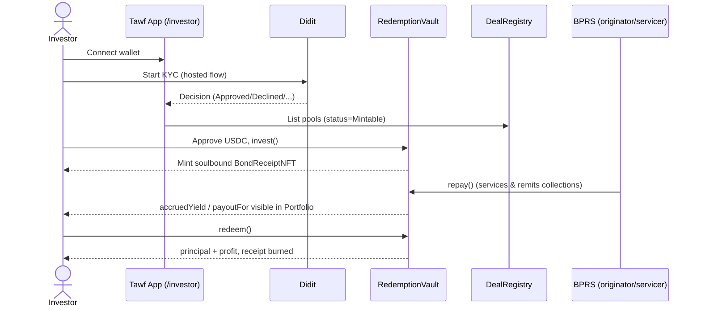
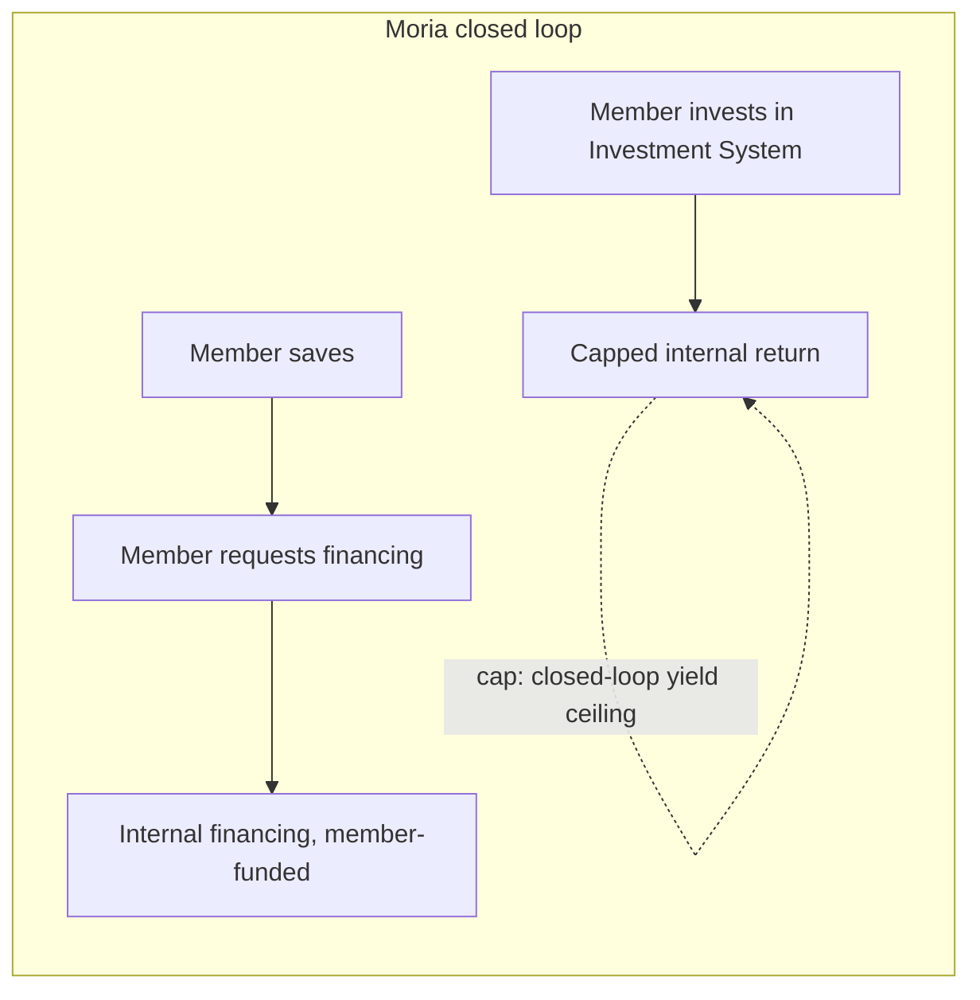
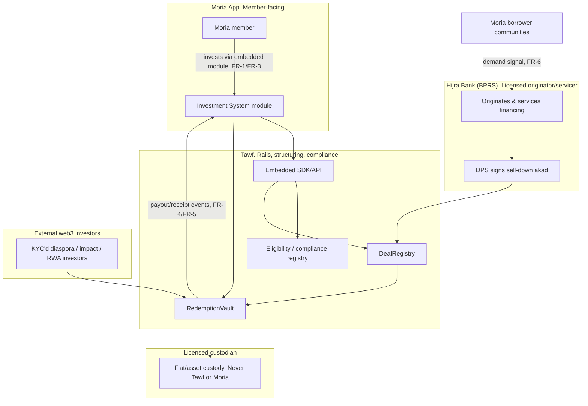

# Business Analysis Report: Tawf x Moria Fund x Hijra Bank Integration

> Scope: end-to-end BA pass on the proposed three-way flywheel described in
> `docs/moria-partnership.md`, grounded in the current live platform
> (`README.md`, `docs/regulation.md`, `docs/secondary-market.md`,
> `docs/competitors.md`, `docs/demo-script.md`, `docs/didit-kyc.md`).
> Produced with the `business-analyst` skill: requirements elicitation → BRD/FRD →
> process modeling → user stories → data-driven analysis → gap analysis.
>
> Status: **exploratory / pre-sign-off.** No stakeholder interviews have been run
> yet with Moria or Hijra. Requirements below are derived from internal docs and
> flagged where they need external validation (see §10).

---

## 1. Executive Summary

Tawf Finance is originator-side infrastructure that lets a licensed Indonesian
Shariah rural bank (BPRS) sell down a pool of its financing to KYC'd investors
on-chain. The platform's hardest problem is a two-sided cold start: it needs
both originators (BPRS pipeline) and investors, and neither shows up without
the other.

Moria Fund is closed-loop internal financial infrastructure (savings,
financing, investment, arisan) already used by companies, cooperatives, and
communities in Indonesia. It cannot lawfully raise capital from non-members and
has no regulator-attestation layer. Tawf's exact complement.

**The proposal:** embed Tawf as a rail inside Moria's Investment System module.
Moria members become a warm-started, KYC'd investor cohort, Moria's borrower
communities become a warm-started financing-demand pipeline for Hijra Bank
(BPRS), Hijra originates and services, and Tawf structures, tokenizes, and
settles the sell-down. Each party does what only it can do (§6.3).

This report turns that brief into: prioritized business/functional
requirements, as-is/to-be process maps, user stories with acceptance criteria,
a SWOT and root-cause pass on the cold-start problem, a capability gap
analysis against the current codebase, and a risk/change-impact log.

**Bottom line for decision-makers:** the integration is buildable on top of
existing primitives (`DealRegistry`, `BondReceiptNFT`, `RedemptionVault`,
Didit KYC) with one new component, an embedded SDK/API surface, and one open
legal question that gates everything: whether member-investing-into-a-bank-pool
via Moria re-triggers the koperasi non-member issuance restriction (§9, R-1).
That must clear counsel before a pilot is scoped.

---

## 2. Stakeholders

| Stakeholder | Interest | Influence | Engagement strategy |
|---|---|---|---|
| Moria Fund | New revenue line/module without origination risk, keeps member relationship | High. Gatekeeper of distribution | Discovery workshop first (§8 agenda), co-design, don't dictate |
| Hijra Bank (BPRS) | Funding beyond district cap, balance-sheet relief, possible new demand pipeline | High. Licensed originator, no deal without them | Sequence Moria conversation *through* Hijra where possible |
| Moria member-investors | Halal yield beyond closed-loop cap, without leaving trusted app | Medium. End user, no direct voice yet | Represented via Moria, validate appetite in discovery |
| Moria borrower communities | Access to BPRS financing sourced through their own community | Medium | Represented via Moria |
| Tawf (product/eng) | Ship compliant rail, solve cold start, keep vault/custody boundaries clean | High. Builds the integration | This report, owns BRD/FRD |
| DPS (Hijra's Shariah board) + independent board | Akad validity for the sell-down structure members invest into | High. Veto power | Structure review before pilot |
| OJK / counsel | Regulatory perimeter, koperasi restriction, licensing triggers | High. Veto power | Legal sign-off gate, see R-1 |
| Licensed custodian | Holds fiat/asset custody, never Tawf or Moria | Medium | Unchanged by this integration |

---

## 3. Requirements Elicitation: sources and method

No live stakeholder interviews yet. This pass used **document analysis** of:

- `docs/moria-partnership.md` (the partnership thesis and integration model)
- `README.md`, `docs/regulation.md` (current product, legal boundaries)
- `docs/secondary-market.md` (transfer-policy roadmap, relevant to how member
  receipts might eventually move)
- `docs/didit-kyc.md`, `docs/demo-script.md` (current KYC and investor flow,
  the surface the integration must extend)

**Gap:** `docs/moria-partnership.md` references `docs/hijra-consultation.md`,
`docs/strategy.md`, and `docs/ecosystem-research.md` as companion reading,
and none of these three files exist in the repo. Treat any claim that depends on
them (e.g. exact investor persona sizing) as unverified until they're found or
re-created.

**Next elicitation step:** run the discovery interview in §8 with Moria, and a
parallel one with Hijra on current Moria×Hijra scope (brief §6, risk 1).

---

## 4. Business Requirements Document (BRD)

### 4.1 Business objectives

| ID | Objective | Success metric |
|---|---|---|
| BO-1 | Solve Tawf's two-sided cold start via a warm-started community | ≥1 signed pilot cohort of Moria member-investors within one quarter of legal clearance |
| BO-2 | Give Moria a new fee-bearing module without origination/licensing risk | Moria agrees to co-design a pilot investment module (§8 "Close") |
| BO-3 | Give Hijra a funding channel beyond its district cap | Hijra sells down ≥1 pool funded partly by Moria-sourced capital |
| BO-4 | Keep the integration inside the existing legal/compliance perimeter | Zero re-classification event. Koperasi restriction confirmed non-triggered by counsel (R-1) |

### 4.2 Business requirements (prioritized, MoSCoW)

| ID | Requirement | Priority | Source |
|---|---|---|---|
| BR-1 | Moria members can discover and invest in Hijra-originated, DPS-signed financing pools from inside the Moria app | Must | Brief §4 |
| BR-2 | The originating legal entity on every pool remains the BPRS (Hijra), never the cooperative/Moria entity | Must | Brief §4, Regulation §2 |
| BR-3 | Moria retains the member-facing relationship and UX. Tawf is not member-facing in this channel | Must | Brief §4, §5 |
| BR-4 | Investor identity/eligibility combines Moria's existing member KYC with Tawf's compliance/eligibility registry | Must | Brief §4 |
| BR-5 | Funds are never held by Tawf or Moria. Custody stays with a licensed custodian/vault, no commingling | Must | Brief §4, Regulation §3.5 |
| BR-6 | Pool registry, structuring, and settlement remain owned by Tawf (`DealRegistry`, `RedemptionVault`) | Must | Brief §4 |
| BR-7 | Integration is exposed as an API/embedded SDK so Moria does not need to build sell-down rails | Must | Brief §4 |
| BR-8 | Moria borrower-community demand can be routed to Hijra as financing-origination pipeline (not just investment) | Should | Brief §2.2 |
| BR-9 | Moria's closed-loop repayment/savings data can (with consent) enrich pool quality signals for the NPF / ZK verification layer | Could | Brief §2.3 |
| BR-10 | Investment product is retail-capped with risk warnings on every primary subscription, matching Tawf's existing investor onboarding | Must | Regulation §3.7 |
| BR-11 | A joint conversation with Hijra is scheduled before/alongside the Moria pilot design | Must | Brief §7 "Close" |

### 4.3 Non-functional requirements

| ID | Requirement | Rationale |
|---|---|---|
| NFR-1 | No dual custody of member funds. Moria never becomes a money-transmission point | Regulatory boundary, brief §4 |
| NFR-2 | Identity data shared between Moria and Tawf is minimized and consented, not a bulk member-list handoff | AML/data-ownership risk, §9 R-5 |
| NFR-3 | SDK/API integration must not require Moria to rebuild its front end. Thin embed only | Keeps Moria's cost of adoption low, brief §4 "Value to Moria" |
| NFR-4 | All member-facing yield/return language stays "Shariah-aligned," never "Shariah-compliant" as a self-claim | Existing Tawf product convention (regulation.md §3.6) |
| NFR-5 | Existing soulbound-receipt / non-transferable posture is preserved for this channel until secondary-market phase 2 ships | secondary-market.md §7 |

---

## 5. Functional Requirements Document (FRD): Moria Integration Surface

Scope: the technical/product behavior needed for BR-1, BR-4, BR-7. This section
is for developers/QA/solution design, one layer down from the BRD.

| ID | Function | Description | Maps to |
|---|---|---|---|
| FR-1 | Embedded pool listing widget | Moria app renders a Tawf-sourced list of Hijra pools (status, target return, tenor, originator) inside its Investment System module | BR-1, BR-7 |
| FR-2 | Eligibility/KYC bridge | On first use, Moria passes member identity claims to Tawf's compliance/eligibility registry. Tawf issues (or checks) an eligibility credential without re-running full KYC if Moria's member KYC meets policy | BR-4 |
| FR-3 | Embedded invest action | Member commits an amount inside Moria's UI. Call proxies to `RedemptionVault.invest` via Tawf's API, settlement in the agreed stablecoin/IDR rail | BR-1, BR-5, BR-6 |
| FR-4 | Receipt visibility | Member sees their position (principal, projected/accrued yield, status) inside Moria, sourced from `BondReceiptNFT` metadata via Tawf API. No wallet UX required from the member | BR-1, BR-3 |
| FR-5 | Redemption/payout event | On maturity or default, Tawf notifies Moria (webhook) so Moria can reflect the payout in-app. Actual fund movement stays on the custodian/vault rail | BR-1, BR-5 |
| FR-6 | Demand-intake channel | Moria can submit aggregated, anonymized financing-demand signals from its borrower communities to Hijra's origination pipeline (human/BD process first, API later) | BR-8 |
| FR-7 | Consented data-sharing hook | Optional, member-consented channel for closed-loop repayment/savings signals to feed pool quality scoring | BR-9 |
| FR-8 | Risk disclosure surface | Every embedded invest action shows the retail cap and standard risk warning before confirmation | BR-10 |
| FR-9 | Co-branding/attribution | UI clearly attributes "Financing originated & serviced by Hijra Bank. Rail powered by Tawf" to keep entity roles legible to the member (audit/regulatory legibility) | BR-2, BR-3 |

**Explicitly out of scope for v1 (per brief §4 boundaries):**
- Moria or Tawf ever holding member funds directly (custodian/vault only).
- Secondary transfer of receipts through Moria (blocked until secondary-market
  phase 2, see secondary-market.md).
- Full data-mesh integration of Moria's closed-loop ledger (starts as
  consented, narrow signal per FR-7, not a data pipeline).

---

## 6. Process Modeling

### 6.1 As-Is: Tawf standalone investor flow (current, live)

**Pain point:** every investor must independently discover Tawf, connect a
wallet, and pass KYC cold. There is no warm distribution channel today. This
is the cold-start bottleneck BO-1 targets.

### 6.2 As-Is: Moria closed loop (today, no Tawf)

**Pain point:** Moria's Investment System can only recycle capital already
inside the loop. Member yield is capped by what the closed loop itself can
generate. Moria has no lawful path to bring in outside capital or outside
yield (brief §1).

### 6.3 To-Be: three-way integrated flow (proposed)

**Handoffs and where they can break:**

| Handoff | Risk if unclear |
|---|---|
| Moria member KYC → Tawf eligibility registry (FR-2) | Duplicate KYC (friction) or under-verified eligibility (compliance risk) if criteria aren't pre-agreed |
| Hijra origination → DealRegistry listing | Pool never reaches Moria members if Hijra's existing Moria relationship isn't looped in (brief risk 1) |
| Vault payout event → Moria in-app reflection (FR-5) | Member sees stale balance if webhook/notification isn't reliable. Reputational risk for Moria, whose brand is member-facing |
| Demand signal (community → Hijra) | Falls into a BD gap if treated as pure API before the relationship is proven. Start manual (FR-6 note) |

---

## 7. User Stories (INVEST): Moria Integration Epics

### Epic A: Embedded discovery & investment (FR-1, FR-3, FR-4, FR-8, FR-9)

**US-A1**
> As a Moria member, I want to see Hijra's available financing pools inside
> the Moria app, so that I don't have to leave an environment I already trust.

- **Given** I am a logged-in Moria member with the Investment System module enabled
- **When** I open the "Bank Financing" tab
- **Then** I see a list of Hijra pools with target return, tenor, status, and "originated & serviced by Hijra Bank, rail powered by Tawf" attribution

**US-A2**
> As a Moria member, I want to invest in a pool without connecting a crypto
> wallet, so that the experience matches the rest of Moria's app.

- **Given** a pool is in `Mintable` status and I am eligible (FR-2 passed)
- **When** I enter an amount within the retail cap and confirm
- **Then** the investment is submitted via the embedded SDK, a soulbound receipt is minted on my behalf, and I see a confirmation with the standard risk disclosure I acknowledged (FR-8)

**US-A3**
> As a Moria member, I want to see my position's status and projected/accrued
> yield inside Moria, so that I don't need a separate portfolio view.

- **Given** I hold one or more receipts from Hijra pools
- **When** I open "My Investments"
- **Then** I see principal, status (Active/Matured/Defaulted), and accrued or projected yield, refreshed from Tawf's API

### Epic B: Eligibility & identity bridge (FR-2)

**US-B1**
> As Moria, I want my existing member KYC to satisfy Tawf's eligibility check
> where possible, so that members aren't asked to re-verify from scratch.

- **Given** a member's KYC level in Moria meets the pre-agreed policy mapping
- **When** the member first opens the investment module
- **Then** Tawf issues an eligibility credential without a redundant full KYC flow. If the member's KYC level is insufficient, they're routed to a top-up flow (not a cold-start KYC)

### Epic C: Payout and lifecycle transparency (FR-5)

**US-C1**
> As a Moria member, I want to be notified in-app when my investment matures
> or defaults, so that I know when and how to act.

- **Given** a held pool transitions to `Matured` or `Defaulted`
- **When** the vault emits the corresponding event
- **Then** Moria receives a webhook and reflects the new status/payout amount in-app within an agreed SLA (to be set with Moria, see §10 open question)

### Epic D: Demand-side pipeline (FR-6)

**US-D1**
> As Hijra Bank, I want visibility into financing demand generated by Moria's
> borrower communities, so that I can grow my origination pipeline beyond what
> I currently source.

- **Given** a Moria community generates financing demand that fits Hijra's product set
- **When** Moria shares an aggregated, anonymized demand signal
- **Then** Hijra's BD team receives it as a qualified lead (manual process for v1, per FR-6 note)

---

## 8. Discovery Workshop Agenda (Moria), ready to run

Carried over from `docs/moria-partnership.md` §7, restated as a BA elicitation
script so it can be run as a structured interview with clear outputs mapped
back to this BRD.

| Step | Ask | Feeds |
|---|---|---|
| Open | Frame Tawf as the compliant rail for a BPRS to sell down financing to KYC'd individuals | Context-setting only |
| Discover Q1 | What does your Investment System offer members today, and what caps returns? | Validates BO-1/BR-1 sizing |
| Discover Q2 | What's your relationship with Hijra Bank today. What does it cover? | Resolves risk R-2 (channel conflict / existing scope) |
| Discover Q3 | Do your member communities generate financing demand a BPRS could serve? | Validates BR-8 |
| Discover Q4 | How do you think about closed-loop vs external regulated access for members? | Validates BO-2, surfaces objections |
| Discover Q5 | What would make a member-facing investment product a "yes," and what are your Shariah/compliance red lines? | Feeds NFR-4, FR-8, R-1 |
| Propose | Walk the to-be diagram (§6.3). Position Tawf as powering a new Moria module, not replacing it |. |
| Close | Get: agreement to co-design a pilot + joint Hijra conversation. Minimum: member-base size, investment-module appetite, Hijra scope, follow-up date | Unblocks BO-1 to BO-4 |

---

## 9. Data-Driven Analysis

### 9.1 SWOT: the Tawf x Moria x Hijra flywheel

| | Helpful | Harmful |
|---|---|---|
| **Internal** | **Strengths:** existing live contracts (Registry/Receipt/Vault) need no redesign, existing Didit KYC bridge extends naturally (FR-2), and Tawf's positioning already excludes custody/origination, so no role conflict with Moria or Hijra | **Weaknesses:** no signed Moria x Hijra scope confirmed yet (R-2), three companion docs referenced in the brief are missing from the repo (§3 gap), and webhook/notification reliability to Moria is unbuilt (FR-5) |
| **External** | **Opportunities:** solves the two-sided cold start in one relationship (BO-1), Moria's closed-loop data could strengthen NPF/ZK verification over time (BR-9), and it is a template for future BMT/cooperative-platform partnerships beyond Moria | **Threats:** koperasi non-member issuance restriction could apply if the structure isn't airtight (R-1), Moria could see the module as channel conflict rather than complement (R-3), and consolidation cycle (POJK 7/2026) could shrink Hijra's runway before pilot lands |

### 9.2 Root cause analysis: the cold-start problem (5 Whys)

1. **Why** is Tawf hard to grow? → It needs both investors and originator
   pipeline simultaneously.
2. **Why** is that hard? → Neither side has a reason to show up first. There's
   no existing trusted distribution channel for either.
3. **Why** is there no existing channel? → Tawf is new infrastructure with no
   built-in community. It depends on partners for both sides of the
   marketplace.
4. **Why** hasn't a partner been used yet? → Prior positioning (BMT-first,
   see commit history `52dd695`, `72792e8`) targeted the wrong lawful
   channel for public investment.
5. **Why** does Moria resolve this? → Moria already aggregates both a
   KYC'd member-investor base *and* borrower-community demand, inside a
   Shariah-aligned trust envelope Tawf doesn't have to build from scratch,
   it warm-starts both sides of the marketplace at once (brief §2).

**Root cause:** the binding constraint isn't product. It's distribution on
both sides simultaneously. The fix is structural (a community partner that
already has both), not incremental marketing.

### 9.3 Cost-benefit: pilot module (illustrative, needs real Moria numbers)

| Cost | Benefit |
|---|---|
| Engineering: embedded SDK/API (FR-1 to FR-5) and eligibility bridge (FR-2), a net-new build on top of existing contracts | Warm-started investor cohort at near-zero CAC compared to cold acquisition |
| BD/legal: counsel time to clear R-1, plus a joint Hijra conversation | Warm-started origination pipeline (BR-8) |
| Ongoing: webhook/notification reliability, attribution/compliance UI (FR-5, FR-9) | Recurring fee base if Tawf takes a rail/settlement fee per the existing revenue model (`secondary-market.md` §6) |
| Risk: legal/regulatory exposure if R-1 resolves unfavorably | Repeatable template for future cooperative/community-platform partnerships |

This is directional only. Plug in real numbers from the Moria discovery
workshop (§8) before treating it as a business case.

---

## 10. Gap Analysis: current platform capability vs integration requirement

| Capability needed | Current state | Gap | Owner |
|---|---|---|---|
| Pool listing/investment API surface for a third-party front end | `/investor/pools` is a first-party React UI reading `DealRegistry` directly. No documented external API/SDK | **Build:** FR-1/FR-3 embedded SDK | Tawf eng |
| Eligibility check reusable without full KYC re-run | Didit KYC is wallet-address-keyed, soft-gated, first-party only (`docs/didit-kyc.md` "Production TODOs") | **Build:** FR-2 bridge + policy mapping with Moria's KYC levels. Also close existing TODOs (webhook HMAC, DB persistence, hard gate) before this is production-safe | Tawf eng |
| Payout/status event delivery to a partner app | No outbound webhook system exists yet (KYC webhook is inbound/log-only) | **Build:** FR-5 outbound event system | Tawf eng |
| Legal clearance for member-investing-into-bank-pool via Moria | Regulation doc covers BPRS sell-down generally. Does not address a cooperative-app-embedded distribution channel specifically | **Resolve:** counsel opinion, see R-1 | Tawf legal / counsel |
| Confirmed Moria×Hijra existing relationship scope | Unknown. Brief explicitly flags this as unverified | **Resolve:** discovery interview (§8 Q2) | BD |
| Entity/name verification (moriafund.com vs unrelated "Moria" entities) | Unverified per brief | **Resolve:** before any outreach | BD |
| Companion strategy docs (`hijra-consultation.md`, `strategy.md`, `ecosystem-research.md`) | Referenced but absent from repo | **Resolve:** locate or re-create before finalizing investor-persona sizing | Tawf team |

---

## 11. Risk Log / RAID (integration-specific, extends brief §6)

| ID | Risk | Likelihood | Impact | Mitigation |
|---|---|---|---|---|
| R-1 | Member-investing-into-bank-pool via Moria re-triggers koperasi non-member issuance restriction | Medium | High (blocks entire integration) | Get counsel opinion before pilot scoping. Structure so BPRS is unambiguously the originating/issuing entity, Moria is UX-only (BR-2, BR-3) |
| R-2 | Existing Moria×Hijra relationship scope is unknown/unconfirmed | Medium | Medium (could duplicate or conflict with existing work) | Discovery Q2 (§8) before proposing new scope |
| R-3 | Moria perceives Tawf as encroaching on its Investment System rather than powering it | Low to Medium | Medium (kills the deal) | Lead every conversation with "we power your module," not "we replace it" (brief §6 risk 3) |
| R-4 | Entity misidentification (wrong "Moria") | Low | High if wasted on wrong outreach | Verify moriafund.com specifically before any BD contact |
| R-5 | Data-sharing (FR-7, NFR-2) drifts into bulk member-data handoff without consent | Low | High (privacy/AML exposure) | Keep FR-7 opt-in, consented, aggregated only. Not a data pipeline by default |
| R-6 | Webhook/notification reliability gap (FR-5) causes stale balances in Moria's UI | Medium | Medium (reputational, Moria-facing) | Define SLA with Moria. Build retry/reconciliation before pilot go-live |
| R-7 | POJK 7/2026 consolidation shrinks Hijra's operating runway before pilot lands | Low to Medium | Medium | Track regulation.md §5 phased timeline. Don't over-commit dates to Moria until Hijra's status is current |

---

## 12. Change Impact Assessment

| Area | Change | Impact |
|---|---|---|
| Product/eng | New embedded SDK/API, outbound webhook system, eligibility-bridge policy mapping | Net-new build. Does not require redesigning `DealRegistry`/`BondReceiptNFT`/`RedemptionVault` |
| Compliance | New partner-channel eligibility criteria. Consented data-sharing policy (FR-7) | Requires updated compliance documentation, counsel sign-off (R-1) before launch |
| BD | New parallel relationship (Moria) alongside existing Hijra relationship | Sequence through Hijra where possible (brief §6 risk 6) to avoid two cold intros |
| Support/Ops | Member support for embedded product technically lives in Moria's support flow, not Tawf's | Needs a support-handoff agreement (not yet in FR list, flag for pilot scoping) |
| Brand/positioning | Tawf becomes partly white-labeled inside Moria's UX (FR-9 attribution) | Consistent with "power the module, keep the relationship" framing. No conflict with Tawf's other channels |

---

## 13. Data Dictionary (terms used across this report)

| Term | Definition |
|---|---|
| BPRS | Bank Pembiayaan Rakyat Syariah. Licensed Indonesian Shariah rural bank, OJK-supervised, LPS-insured |
| BMT | Baitul Maal wat Tamwil. Islamic cooperative financial institution. Cannot lawfully issue investment instruments to non-members |
| DPS | Dewan Pengawas Syariah. A bank's Shariah supervisory board. Must sign off on the sell-down akad |
| Sell-down | The BPRS originates and services financing. An outside investor pool takes economic exposure to a defined slice of it via a compliant akad |
| Wakalah bil istithmar | Investment-agency Shariah contract structure used for the sell-down |
| Musyarakah | Partnership-based Shariah contract structure, also used for the sell-down |
| DealRegistry | Tawf's on-chain contract managing deal lifecycle state (Submitted → BmtApproved → Mintable → Active → Matured → Completed/Defaulted) |
| BondReceiptNFT | Soulbound (non-transferable) ERC-1155 receipt representing an investor's position |
| RedemptionVault | Escrow/settlement contract: invest, repay, redeem, claimDefault |
| NPF | Non-Performing Financing ratio. A pool quality signal |
| Eligibility/compliance registry | The whitelist/credential layer determining who may invest (KYC/KYB, jurisdiction, Shariah eligibility) |
| Closed-loop (Moria) | A financial system used only by a company/cooperative/community's own members, never the public |

---

## 14. Open Questions / Next Steps (sign-off checklist)

- [ ] Confirm target entity is moriafund.com (R-4)
- [ ] Run Hijra-side discovery: current Moria×Hijra scope, if any (R-2)
- [ ] Run Moria discovery workshop using §8 agenda. Capture real member-base
      size and appetite numbers to replace the illustrative figures in §9.3
- [ ] Get counsel opinion on R-1 (koperasi non-member issuance restriction)
      before scoping a pilot
- [ ] Locate or re-create `docs/hijra-consultation.md`, `docs/strategy.md`,
      `docs/ecosystem-research.md` referenced by the partnership brief
- [ ] Define support-handoff model between Moria and Tawf (flagged in §12,
      not yet a formal FR)
- [ ] Define webhook/notification SLA with Moria (R-6, US-C1)
- [ ] Once discovery is complete, promote this BRD/FRD to a signed-off version
      and break Epic A to D (§7) into a delivery backlog

---

*Generated via the `business-analyst` skill workflow (requirements elicitation →
BRD/FRD → process modeling → user stories → data-driven analysis →
documentation). All figures marked "illustrative" require real stakeholder
input before being used in an external-facing business case.*
