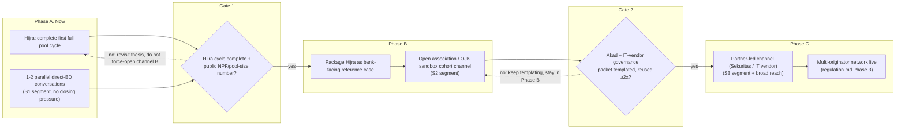

# Go-to-Market Strategy: Scaling Tawf from One Design-Partner BPRS to a Multi-Originator Network

> Produced with the `business-consultant` skill. Extends the channel/phasing
> recommendation given in-chat into a full engagement deliverable: framing,
> issue tree, segmentation, options with a business case, recommended roadmap,
> operating-model build-out, and an executive one-pager.
>
> Companion documents: `docs/regulation.md` (legal sequencing this GTM must
> respect), `docs/ba-report-moria-partnership.md` (investor/demand-side
> cold-start, a different problem from this one), `docs/pitch-outline.md`
> (product narrative this GTM packages for banks).
>
> Status: **strategy draft, pre-sign-off.** Segmentation (§3) is grounded in
> OJK sector data. Province and size-tier granularity is from Statistik
> Perbankan Syariah, Maret 2025, the last period OJK published as a
> downloadable table before moving to the interactive Portal Data in July
> 2025. Headline counts and risk signals are refreshed to September 2026
> using OJK press releases, HIMBARSI reporting, and news coverage (§3.1,
> §3.8). The one remaining gap is per-bank core-capital data, not
> sector/province data (§3.6).

---

## 1. Engagement framing

**Decision this document supports:** how Tawf moves from *one* design-partner
BPRS (Hijra) to a repeatable motion that signs additional BPRS originators,
without front-running the proof discipline the BMT to BPRS pivot was built on
(`regulation.md` §2, `pitch-outline.md` "Sequencing").

**Sponsor / decision-owner:** Tawf leadership (BD + product). Decision by:
phase-gated, not calendar-gated, see §5.

**If we do nothing:** Tawf stays a single-originator platform indefinitely.
The thesis in `regulation.md` §5 (Phase 3: "multi-originator network, then SEA
passporting") never activates, and the two-sided cold-start problem this GTM
exists to solve on the *supply* side compounds the one already being solved
on the *demand/investor* side via Moria.

**Success criteria (draft, confirm with leadership):**
- SC-1: ≥2 additional BPRS signed as design/pilot partners within 2 quarters
  of Hijra completing one full pool cycle (invest → repay → redeem).
- SC-2: Per-bank sales-cycle time drops materially from Hijra's baseline once
  the akad and IT-vendor governance packages are templated (§6).
- SC-3: At least one non-direct-BD channel (association/sandbox cohort or
  partner-led) produces a qualified lead, proving the channel thesis in §4.

**Scope:**
- **In scope:** originator-side (BPRS) go-to-market: segmentation, channel,
  offer design, sales motion, phasing, capability build.
- **Out of scope:** investor/demand-side acquisition (covered in
  `docs/ba-report-moria-partnership.md`), consumer marketing, SEA expansion
  sequencing beyond Indonesia (covered at a regulatory level in
  `regulation.md` §4, not re-litigated here).

**Hypotheses (testable, not conclusions):**
1. The strongest next-BPRS targets are sub-IDR-6bn-core-capital banks under
   direct POJK 7/2026 pressure, not the largest or most digitally mature BPRS.
2. A live Hijra reference (completed cycle, public NPF number) is the unlock.
   Cold outbound before that stalls inside the 6 to 18 month IT-vendor
   procurement cycle (`regulation.md` §1).
3. An association/OJK-sandbox-cohort channel converts faster than one-by-one
   direct BD, but only *after* a reference exists. Used earlier, it wastes
   the credibility play.
4. The binding constraint on Tawf's side is BD bandwidth and akad/legal
   template reuse, not the product. `DealRegistry`/`RedemptionVault`/
   `BondReceiptNFT` are already bank-agnostic (README "Smart Contracts").
5. Pricing/reference-partner economics for bank #2 to 3 need to be decided
   explicitly (discount for being an early reference vs. full fee), not
   defaulted.

---

## 2. Issue tree: "How do we scale beyond Hijra?"

```
Scale to multi-BPRS
├── WHO, which BPRS are the right next targets? (§3)
│   ├── Segment: sub-IDR 6bn core capital (POJK 7/2026 pressure) vs already-compliant
│   ├── Segment: funding-cost gap severity (deposit-rate ceiling bite)
│   ├── Segment: digital/IT readiness (vendor-governance review speed)
│   └── Segment: regional cluster (proximity to Hijra = shared DPS network, easier referencing)
├── WHAT do we sell them, the offer (§4.2)
│   ├── Proof package: Hijra case study, live pool, akad template, sandbox precedent
│   ├── Commercial terms: structuring/servicing fee, no upfront licence cost
│   └── Risk reversal: small first pool, DPS-signoff opt-out
├── HOW do we reach them, the channel (§4)
│   ├── A. Direct BD (bank-by-bank)
│   ├── B. HIMBARSI, the BPRS industry association
│   ├── C. Partner-led (Sekuritas or BPRS core-banking/IT vendor)
│   └── D. Community-platform channel (Moria-style), wrong tool, demand-side not originator-side
├── WHY they say yes, the value prop (§4.2)
│   ├── Funding priced outside the 6.25% local deposit cap
│   ├── CAR/BMPK relief without diluting ownership or raising core capital
│   └── Consolidation-cycle defense ahead of POJK 7/2026
└── WHAT blocks the sale, the objections (§7)
    ├── "No BPRS will give up yield to release capacity" (thesis's own stated falsifier)
    ├── IT-vendor governance / procurement cycle (6 to 18 months)
    ├── Board risk aversion to anything on-chain / unprecedented
    └── DPS willingness, every bank's DPS signs independently, no shortcut
```

---

## 3. Segmentation: WHO to target next

> **Update:** the data gap flagged in the original draft is now closed for
> everything *except* per-bank core capital. Figures below are pulled directly
> from OJK's **Statistik Perbankan Syariah, Maret 2025** (Tables 2, 26, 42,
> 43, 44) and recent OJK consolidation reporting. See §3.6 for sourcing and
> the one remaining gap.

### 3.1 Sector snapshot (BPRS, sector-wide, March 2025, with a September 2026 update)

| Metric | Value (Mar 2025) | Read for GTM |
|---|---|---|
| Number of BPRS | **174** (up from 164 in 2021, 167 in 2022, 173 in 2023, the population has been essentially flat since 2023, consolidation netting out against slow entry) | The addressable universe is small and known. This supports a direct-BD-first motion (§5), not a mass-market channel |
| Total assets | IDR 24.58 trillion | Whole-sector scale, for context against Hijra's individual pool sizes |
| Total financing (pembiayaan) | IDR 19.43 trillion | The pipeline of financing already originated sector-wide, the addressable "sell-down" base if even a slice became poolable |
| Total deposits (DPK) | IDR 16.63 trillion | |
| **Sector-wide FDR** | **116.84%** | **This is the single strongest data point for the pitch.** The sector is already lending *more* than it collects in deposits. BPRS as a whole are balance-sheet constrained *today*, not hypothetically. This is Tawf's thesis, confirmed at the sector level. |
| Sector-wide NPF | 8.83% | Materially higher than commercial Islamic banks (BUS NPF gross ~2.16% to 2.28%, UUS ~2.33%, see the 2026 update below). Set investor return and risk expectations accordingly. This is also the number the ZK pool-verification layer needs to make legible per pool, not just sector-wide |
| Sector-wide CAR | 24.47% | Capital-adequate as a sector. The constraint is funding and liquidity (FDR), not solvency, though see §3.8 for what happens when an individual bank's capital position is *not* adequate |
| ROA / ROE / BOPO | 1.86% / 18.37% / 93.43% | Thin operating margins (BOPO above 90%). A bank's cost sensitivity to a new "IT vendor" is real. Keep the offer's cost-to-adopt low (NFR-3 in the companion BA report) |

Source: [OJK, Statistik Perbankan Syariah, Maret 2025](https://www.ojk.go.id/id/kanal/syariah/data-dan-statistik/statistik-perbankan-syariah/Documents/Pages/Statistik-Perbankan-Syariah---Maret-2025/STATISTIK%20PERBANKAN%20SYARIAH%20-%20MARET%202025.pdf), Tables 2, 26, 42, 44. This was the last period OJK published as a downloadable statistical table for BPRS specifically. Since the July 2025 period, OJK moved this release to the interactive Portal Data ([data.ojk.go.id/SJKPublic](https://data.ojk.go.id/SJKPublic)), which does not expose the same province and size-tier breakdown through search or extraction tools. Province and size-tier figures in §3.2 through §3.4 below are therefore still the March 2025 snapshot. Headline counts and risk signals are refreshed below using other 2026 sources.

**September 2026 update, from HIMBARSI and OJK/LPS reporting (see §3.8 for full detail and sourcing):**

- BPRS count has drifted down to **roughly 172**, per HIMBARSI (the BPRS industry association, see §5.1) reporting membership falling from 175 to 172 through 2026, consistent with continued consolidation and the closures in §3.8. Treat 172 to 174 as the working range rather than a single precise figure until a fresh province-level table is available.
- The wider sharia banking industry (BUS and UUS combined, not BPRS) is healthy and a useful contrast: as of March 2026, assets grew 10.49% year on year to IDR 1,061.61 trillion, financing grew 9.82% to IDR 716.40 trillion, DPK grew 11.14% to IDR 811.76 trillion, FDR reached 87.65%, and NPF gross and net were 2.28% and 0.87% respectively (OJK press release, 16 May 2026). This is the opposite risk profile from BPRS specifically: BUS and UUS are growing, well under 100% FDR, and low NPF. **BPRS is the constrained, high-risk segment of Islamic banking, not a proxy for the sector as a whole.** Keep this distinction explicit whenever this document's numbers are used outside Tawf.
- Thirteen BPR and BPRS had their business licences revoked by OJK between January and September 2026, two of them BPRS in Jawa Barat, the primary target cluster recommended in §3.7. See §3.8.

### 3.2 Size distribution (number of BPRS by total assets, Mar 2025)

| Total assets tier | Count | % of sector |
|---|---|---|
| < IDR 1 billion | 1 | 0.6% |
| IDR 1 to 5 billion | 2 | 1.1% |
| IDR 5 to 10 billion | 4 | 2.3% |
| **> IDR 10 billion** | **167** | **96.0%** |

**Important limitation:** this is a *total-assets* tier, not a **modal inti**
(core capital) tier. The metric POJK 7/2026's IDR 6bn floor actually
regulates. OJK's public aggregate release doesn't break out core capital
by bank. 96% of BPRS already clear IDR 10bn in *assets*, but assets are
leveraged off deposits + capital, so this cannot be read as "96% already
meet the core-capital floor." See §3.6 for how to close this specific gap.

### 3.3 Geographic concentration (number of BPRS by province, Mar 2025)

| Province | Count | Share |
|---|---|---|
| Jawa Barat | 27 | 15.5% |
| Jawa Tengah | 27 | 15.5% |
| Jawa Timur | 26 | 14.9% |
| D.I. Yogyakarta | 13 | 7.5% |
| Sumatera Barat | 13 | 7.5% |
| Nanggroe Aceh Darussalam | 11 | 6.3% |
| Lampung | 11 | 6.3% |
| Banten | 9 | 5.2% |
| Sulawesi Selatan | 7 | 4.0% |
| Sumatera Utara | 6 | 3.4% |
| All other provinces (14 provinces, 1 to 3 each) | 24 | 13.8% |
| **Java total** (Jabar+Jateng+Jatim+DIY+Banten+DKI) | **103** | **59.2%** |
| **Total** | **174** | 100% |

Roughly 20 of Indonesia's 38 provinces have **zero** BPRS (all of Papua's
five provinces, Kalimantan Barat/Utara, Sulawesi Utara/Tenggara/Gorontalo,
Maluku, NTT, Jambi). The addressable market is not just small (174 banks),
it's also geographically concentrated. Java alone is 59% of it, and West Java
specifically ties with Central Java for the single largest provincial count.

### 3.4 Province-level capacity/quality signal (Table 44, Mar 2025)

The real targeting lens isn't just "biggest province". It's **funding
capacity constraint (FDR) crossed with credit quality (NPF)**, since that's
what predicts both "will this bank want a sell-down" and "will investors be
comfortable with the risk."

| Province | Assets (IDR mn) | FDR | NPF | Read |
|---|---|---|---|---|
| **Jawa Barat** | 7,291,526 | 127.65% | 8.72% | Largest sector by assets (30% of national total), high FDR, moderate NPF. The anchor cluster, and where Hijra already sits |
| **Nusa Tenggara Barat** | 1,746,302 | 123.83% | **0.99%** | 4th-largest by assets, high FDR (capacity-constrained), *lowest NPF of any material province*. The strongest risk-adjusted target cluster, only 3 banks (so likely larger, more consolidated institutions) |
| **D.I. Yogyakarta** | 1,741,311 | 116.27% | 8.00% | Large, high bank count (13), near-tied with NTB on assets |
| **Sumatera Barat** | 752,134 | 126.00% | 4.52% | Second-lowest NPF among high-FDR provinces, 13 banks. Strong secondary cluster |
| **Jawa Tengah** | 4,086,088 | 118.20% | 9.14% | 2nd-largest by assets, 27 banks. High volume, average risk |
| **Lampung** | 1,061,857 | 155.35% | n/a in extract | Highest FDR observed. Most acutely funding-constrained single province |
| Nanggroe Aceh Darussalam | 890,867 | 129.97% | **19.59%** | High FDR but very high NPF. Funding-constrained but higher credit risk, deprioritize as an early reference |
| Jawa Timur | 3,074,662 | 100.09% | 12.76% | Large but FDR near 100% (less acutely constrained) and higher NPF than Jabar/DIY |

**Read for phasing:** Jawa Barat is the natural Phase A anchor (scale +
proximity to Hijra's own network + reasonable NPF). **NTB and Sumatera Barat
are the strongest risk-adjusted secondary targets** for Phase A's second
parallel conversation or Phase B's cohort pitch. Better NPF than Java
without giving up meaningful FDR-driven urgency. Aceh's FDR is attractive but
its NPF (19.59%, vs 8.83% sector-wide) argues against using it as an early
reference case even though the "why now" story is strong.

### 3.5 Consolidation context (validates urgency, doesn't change the target list)

- OJK approved consolidation of **81 BPR/BPRS into 24 entities** by the end
  of June 2026, with hundreds more still in the merger and consolidation
  queue, per [Antara News](https://www.antaranews.com/berita/5639331/ojk-81-bpr-bprs-disetujui-untuk-konsolidasi-per-akhir-juni-2026) and [Kompas](https://money.kompas.com/read/2026/07/08/054200726/ojk-restui-81-bpr-merger-jadi-24-bpr-ratusan-masih-antre). An earlier April 2026
  snapshot put the count at 57 entities merged into 18, so the pace has been
  roughly linear through the middle of 2026.
- POJK 7/2026 (effective 30 June 2026) confirmed the core-capital floor
  **stays at IDR 6 billion** rather than rising further, but reaffirmed the
  compliance deadline mechanics, per [Kompas](https://money.kompas.com/read/2026/07/03/193200926/ojk-rilis-aturan-baru-permodalan-bpr-modal-inti-minimum-tetap-rp-6-m).
- Total BPR count nationally (conventional and sharia) is declining, from
  1,356 at the end of 2024 to 1,345 by March 2025, confirming the squeeze is
  active, not theoretical.
- LPS confirmed the OJK consolidation programme continues through 2027 and
  2028, and is building a real time core system specifically to track it, per
  [Bisnis.com](https://finansial.bisnis.com/read/20260913/90/2003679/13-bank-bangkrut-di-indonesia-hingga-september-2026-ini-daftarnya). Consolidation pressure on this segment is a multi year condition, not a
  2026 event that resolves itself.
- **Implication for targeting:** don't try to identify "which specific banks
  are below IDR 6bn" from public aggregate data, not available, see §3.6. The
  consolidation-approval lists, 81 named entities and growing, are a better
  proxy for "banks OJK has already flagged as sub-scale" and worth pulling by
  name from OJK's consolidation announcements as a *negative* filter. A bank
  already mid-merger is a worse near-term sales target than one that isn't.
  The closures in §3.8 are a stronger negative filter still.

### 3.6 Remaining data gap, and how to close it

Public aggregate OJK statistics do not publish core-capital (modal inti) by
individual bank. Only sector totals and the total-*assets* tier in §3.2.
To get an actual bank-by-bank target list (not just a province/segment
shortlist), two next steps, in order of effort:

1. **OJK iBPRS portal** ([ibpr-s.ojk.go.id](https://ibpr-s.ojk.go.id/InformasiUmum)) publishes individual BPRS profiles filterable by province/city. Check whether core capital or a usable proxy (total assets, equity) is exposed per bank. This is a research task, not a data-analysis task, someone needs to query it directly, ideally BD, not this document.
2. **OJK Data Portal** ([data.ojk.go.id/SJKPublic](https://data.ojk.go.id/SJKPublic)) is the successor to the PDF statistical release, and may expose more granular, filterable series than the static PDF used for §3.1 to 3.4.

Until that pull happens, treat §3.4's province-level table. Not a
bank-name list. As the actionable segmentation output of this document.

### 3.7 Segments (revised, using real proxies)

| Segment | Profile (real data) | Priority | Rationale |
|---|---|---|---|
| **S1, Jawa Barat cluster** | 27 BPRS, IDR 7.29tn assets (30% of sector), FDR 127.65%, NPF 8.72% | **Primary target, Phase A** | Largest scale, high funding-constraint signal, Hijra's home cluster. Cheapest referencing cost (regional/scholar-network proximity, brief §6 risk mitigation) |
| **S2, NTB / Sumatera Barat cluster** | NTB: 3 large banks, NPF 0.99%, FDR 123.83%. Sumbar: 13 banks, NPF 4.52%, FDR 126.00% | **Primary target, Phase A second conversation / Phase B cohort anchor** | Best risk-adjusted profile in the country. The reference case to lead with once a second data point beyond Hijra is needed, especially for investor-facing credibility |
| **S3, Jawa Tengah / Jawa Timur / DIY cluster** | 66 BPRS combined (38% of sector), high volume, average-to-elevated NPF (8 to 13%) | **Phase B cohort, volume play** | Where an association/sandbox cohort pitch pays off most: large count, already used to being pitched as a segment |
| **S4, High-FDR, high-NPF provinces (Aceh, Kalimantan pockets)** | Strong "why now" (FDR above 120 to 150%) but NPF well above sector average (19 to 27% in extracted rows) | **Deprioritize for early references, revisit in Phase C** | Real financing-capacity need, but too much credit-risk noise to be a clean reference case while Tawf only has 1 to 2 live proof points |
| **S5, Zero/low-BPRS provinces (Papua, Kalimantan Barat/Utara, Sulawesi Utara/Tenggara/Gorontalo, Maluku, NTT, Jambi)** | No or minimal BPRS presence | **Out of scope** | No addressable target, not a gap in this analysis, a gap in the market itself |

### 3.8 New finding, September 2026: bank failures, including two in the primary target cluster

This is a material update to the S1 recommendation above and needs to be
read before anyone acts on it.

**Thirteen BPR and BPRS had their business licences revoked by OJK between
January and September 2026**, the most recent on 1 September 2026 (PT BPRS
Gaido Indonesia, Cianjur). Sources: [detikFinance](https://finance.detik.com/moneter/d-8644803/ojk-cabut-izin-usaha-bprs-gaido-indonesia), [detik Jabar](https://www.detik.com/jabar/berita/d-8647724/daftar-13-bank-yang-tutup-pada-2026-ada-bpr-dari-jabar-hingga-sumbar), [Kompas](https://money.kompas.com/read/2026/09/02/145940326/13-bpr-dan-bprs-tutup-sepanjang-2026-gelombang-penutupan-diprediksi-berlanjut), [Bisnis.com](https://finansial.bisnis.com/read/20260913/90/2003679/13-bank-bangkrut-di-indonesia-hingga-september-2026-ini-daftarnya).

Two of the thirteen are BPRS, and both are in **Jawa Barat**, the province
this document recommends as the S1 primary target:

- **PT BPRS Hasanah Mandiri** (Depok, Jawa Barat)
- **PT BPRS Gaido Indonesia** (Cianjur, Jawa Barat), placed under BDP status
  (Bank Dalam Penyehatan, a formal recovery/supervision status) from 15
  August 2025 before its licence was pulled on 1 September 2026

Both closures were attributed to capital and liquidity problems (masalah
permodalan dan likuiditas) that the banks failed to resolve during a
recovery period, the standard OJK failure pathway, not a sudden event.

**What this changes, and what it doesn't:**

- It does not undermine the S1 recommendation itself. Jawa Barat is still
  the largest cluster by count and assets, and the same FDR pressure that
  makes it an attractive "why now" story is mechanically the same pressure
  that can tip an undercapitalized bank into failure. Both readings come
  from the same underlying fact.
- It does mean **the segmentation in §3.4 and §3.7 is a starting filter,
  not a target list**. Before approaching any specific Jawa Barat BPRS, screen
  for current supervisory status (not under BDP or equivalent), not one of
  the growing consolidation-approval list in §3.5, and reasonably current
  capital adequacy, not just the 2025 sector-average CAR of 24.47% used in
  §3.1.
- It strengthens, rather than weakens, the case for **product line 1, the
  portfolio and NPF tool** (see `regulation.md` §2.1): a bank already
  circling BDP status is a bank whose own risk visibility was probably poor
  well before the licence was pulled. That is a harder sell for the
  investment rail but a more receptive one for the ops tool, if reached
  early enough, and a clear signal of exactly which banks not to approach
  for either product.
- LPS itself has flagged that BPR-level data is "not all up to date or real
  time," and is building new infrastructure to fix that on its own side.
  That is an independent confirmation of the same data-quality problem this
  document's product line 1 already targets, from the regulator and deposit
  insurer, not just from Tawf's own read of the sector.

---

## 4. Channel options: business case

### 4.1 Options and trade-offs

| Option | Speed | Control | Scalability | Regulatory exposure | Cost to Tawf | Verdict |
|---|---|---|---|---|---|---|
| **A. Direct BD, bank by bank** | Slow, 6 to 18 month cycle per bank | High, Tawf owns pitch, terms, and the DPS relationship | Low, bound by BD headcount | Low, Tawf owns diligence each time | Medium, BD time intensive, no channel cost | **Use now, Phase A** |
| **B. HIMBARSI (the BPRS industry association)** | Medium, but only usable post reference | Medium, shared narrative, less one to one tailoring | High, one pitch, many banks | Low, association-adjacent credibility *reduces* perceived risk | Low, one pitch amortized across many banks | **Use post-Hijra-cycle, Phase B** |
| **C. Sekuritas or BPRS IT-vendor partner-led** | Fast once live, a partner already has 20 to 50 plus bank relationships | Low, the partner owns part of the relationship and margin | High | Medium, the partner's licensed scope must map cleanly onto `regulation.md` §1's role split | Medium to high, margin and control given up | **Use post-templating, Phase C** |
| **D. Community-platform channel (Moria-style)** | Not applicable for originator acquisition | Low for the bank side | Low for this purpose | Not applicable | Not applicable | **Rejected for this GTM.** Solves investor and demand cold start, not originator acquisition, see `docs/ba-report-moria-partnership.md` |

**On option B specifically:** the generic "association or OJK sandbox
cohort" channel from the original draft now has a name. **HIMBARSI**
(Perhimpunan Bank Perekonomian Rakyat Syariah Seluruh Indonesia) formally
launched in December 2024 as its own organization, spun out of what had
been the BPRS compartment inside ASBISINDO (the broader Indonesian sharia
banking association), while still sharing a house with ASBISINDO. It is
the actual named channel to approach for Phase B, not a category to
research from scratch later.

### 4.2 Offer design (constant across phases, what changes is channel)

| Element | Content |
|---|---|
| Proof package | Hijra case study: live pool, completed cycle, NPF number, akad precedent, sandbox status |
| Commercial terms | Structuring + servicing fee per funded pool. No upfront licence cost to the bank (matches `pitch-outline.md` "Business model") |
| Risk reversal | Small first pool size. DPS-signoff is a hard gate the bank fully controls. Tawf never pre-commits a bank to a structure its DPS hasn't cleared |
| Value prop (bank's PoV) | Funding priced outside the 6.25% local deposit cap, CAR/BMPK relief without diluting ownership or raising core capital, and a funding lever ahead of POJK 7/2026 consolidation |
| **Distribution posture (new)** | A choice, not a default: **marketplace** (list on app.tawf.finance, fastest to launch) or **white-label** (embedded inside the bank's own app, Tawf invisible to the bank's own customers). See §4.2.1 |

#### 4.2.1 White-label as a distinct offer, not just a variant

Everywhere above, "the offer" implicitly assumed posture 1, the bank's pool
gets listed on Tawf's own marketplace. `regulation.md` §1.1 documents a
third posture that should be offered explicitly, not left as a custom
request: the bank's own investment product, embedded inside the bank's own
banking app, with Tawf never visible as a counterparty.

**Why this is worth adding to the standard offer, not just a one-off
build:**

- It directly answers the strongest objection in §7's table, board
  aversion to sending the bank's own depositors to an external brand.
  White-label removes the objection instead of arguing against it.
- It is a genuine choice for the client, not a rebrand. A bank that wants
  fast time-to-market and doesn't mind an external listing takes the
  marketplace posture. A bank that wants to deepen its own retail
  relationship and control the full customer experience takes white-label.
  Offering both, explicitly, is a stronger sales conversation than only
  having one.
- It reduces the pressure toward product line 4 (Tawf originating its own
  book, `regulation.md` §2.2). White-label gets Tawf closer to the bank's
  own customer relationship without any of product line 4's competitive
  risk, since the bank still originates, services, and owns the
  relationship end to end.

**What it costs to offer:** an embed is slower to build per bank than a
marketplace listing (it's integration work on the bank's side, not just a
listing on Tawf's side), so it should enter the standard offer once the
akad and IT-vendor governance packages are templated (§6), not on bank #1.
Sequence it as part of the Phase B cohort pitch (§5) onward, when HIMBARSI
banks can be offered a choice from the start rather than retrofitted later.

### 4.3 Cost-benefit by phase (illustrative, replace with real BD cost data)

| Phase | Primary cost | Primary benefit | Gate to enter |
|---|---|---|---|
| A, Direct BD (1 to 2 parallel targets) | BD time, no channel fee | Second/third data point on hypothesis 1 (yield-for-capacity trade), doesn't dilute focus on Hijra | None. Can start now, capped at 1 to 2 parallel conversations |
| B, HIMBARSI | Low, one prepared pitch/reference packet | High-leverage multiplier: one room, many boards, association-adjacent trust transfer | Hijra completes one full pool cycle with a public, verifiable NPF/pool-size number |
| C, Partner-led (Sekuritas/IT vendor) | Margin and some relationship control given to partner | Reach beyond BD headcount, taps partner's existing 20 to 50+ bank book | Akad review and IT-vendor governance packet are templated, not bespoke per bank |

---

## 5. Recommended roadmap (sequenced, phase-gated)



**Why gates, not dates:** `regulation.md`'s own risk log names "a BPRS may
refuse to sell down financing if the yield given up exceeds the value of
released capacity" as the central commercial assumption to test *before*
building further. Gating channel-opening on proof, not a calendar, keeps this
GTM from repeating the mistake the BMT→BPRS pivot was designed to fix:
choosing a channel before the underlying claim is validated.

**Explicitly rejected:**
- **Association-first:** no reference to show yet. Wastes the one credible
  shot at that room on an unproven pitch.
- **Partner-led-first:** before the akad/onboarding process is templated,
  the partner would be selling a bespoke consulting engagement per bank,
  which defeats the purpose of a scalable channel and gives away margin for
  no scale benefit.

---

## 6. Operating-model build-out: what makes bank #2 cheaper than bank #1

This is the real scaling lever, ahead of channel choice: today, the "product"
sold to a bank is partly bespoke consulting (per-bank akad review, per-bank
IT-vendor governance walkthrough). To make each subsequent bank materially
cheaper to close:

| Capability | Current state | Build needed | Owner |
|---|---|---|---|
| Akad review template | Hijra's sell-down akad, reviewed once with a DSN-MUI scholar and Hijra's DPS | Generalize into a template a *new* bank's DPS reviews against deltas, not from scratch | Tawf + Shariah board |
| IT-vendor governance packet | Implicitly assembled per `regulation.md` §1 obligations, not yet packaged | Standard vendor-security/governance dossier reusable across banks, shortening the 6 to 18mo procurement cycle | Tawf compliance |
| Reference asset | Narrative only (`pitch-outline.md`) until Hijra's cycle completes | Numeric case study: pool size, NPF, cycle-completion evidence, akad-compliance verification. The actual sales asset | BD + product |
| Pricing model for reference partners | Undefined (hypothesis 5, §1) | Explicit decision: discount vs. full fee for early-reference banks | Leadership |
| BD process fit for 6 to 18mo procurement cycles | Ad hoc (one relationship, Hijra) | A defined sales-stage process keyed to the IT-vendor review cycle, so BD effort is paced correctly across multiple simultaneous long-cycle deals | BD lead |
| Governance forum | None yet. Single-bank stage | Lightweight partner/originator review cadence once ≥3 banks are live (fits `regulation.md` Phase 3 "multi-originator network") | Tawf leadership |

---

## 7. Objection handling (WHAT blocks the sale)

| Objection | Response |
|---|---|
| "No BPRS will give up yield to release capacity." | This is the thesis's own named falsifier (`regulation.md` §6, `pitch-outline.md`). Treat it as a live test, not a solved problem. Phase A's 1 to 2 parallel conversations exist specifically to gather a second and third data point before scaling spend on channel B or C. |
| "6 to 18 month IT-vendor procurement cycle is too slow to build a business on." | True for bank #1. The templating work in §6 is explicitly designed to compress this for bank #2 and beyond. Don't promise compression before the packet exists. |
| "Board risk aversion to anything on-chain." | Lead with the regulator-attestation framing already in the product narrative (BPRS is OJK-supervised, LPS-insured, reports into SLIK, see `regulation.md` §2). The *bank* is the trust anchor, not the chain. If the objection is specifically about sending the bank's own customers to an external brand, offer the white-label posture (§4.2.1) instead of the marketplace listing, it removes the objection rather than arguing against it. |
| "DPS won't sign without seeing another bank's DPS already have." | This is exactly why Phase B (cohort, post-reference) exists. Don't try to out-argue this objection in Phase A, sequence around it instead. |

---

## 8. Executive one-pager

> **Recommendation:** Don't open a second acquisition channel yet. Finish
> proving Hijra, one complete pool cycle with a public NPF number, then
> sell *that proof*, not the platform, through an association/sandbox cohort,
> before handing distribution to a partner.
>
> **Sequence:** Direct BD, 1 to 2 parallel conversations (now) → reference-led
> cohort channel (post-first-cycle) → partner-led scale (post-templating).
>
> **Ask of the room:** agree the phase gate is *"Hijra completes one full
> pool cycle with a public NPF/pool-size number,"* not a calendar date. Also
> decide now: (1) pricing/discount policy for early-reference banks (§6), and
> (2) which of the two next-conversation clusters to open first. **Jawa
> Barat (S1, scale + Hijra proximity)** or **NTB/Sumatera Barat (S2, best
> risk-adjusted profile, NPF under 5%)**. Both are real, sourced targets now
> (§3.4, §3.7), not placeholders.
>
> **Risks flagged for follow-up:** the yield-for-capacity assumption is
> unvalidated beyond Hijra (§7). Per-bank core-capital data still needs a
> direct OJK iBPRS/data-portal pull before a bank-*name* target list can be
> built (§3.6). Partner-led channel (Phase C) carries role-split regulatory
> risk that needs counsel review before activation (`regulation.md` §1).

---

## 9. Handoff notes for delivery

If this roadmap is approved:

| Output needed next | Owner skill |
|---|---|
| Akad-review and IT-vendor governance templates as concrete artifacts | `business-analyst` (FRD-style spec) or legal/compliance directly |
| BD sales-stage process and pipeline tracking for long-cycle deals | `technical-program-manager` if formal cadence/RAID is wanted |
| Pricing/reference-partner commercial terms | Commercial/legal (`commercial-counsel` for contract terms once terms are decided) |
| Per-bank core-capital data pull (iBPRS portal / OJK data portal, §3.6) | BD/research. Sector and province-level data is now sourced (§3), bank-name-level data is not |

Open assumptions this document leaves for leadership to validate: success
criteria in §1 (numbers are draft), pricing policy for early-reference banks
(§6), and the real segmentation list (§3.1).
