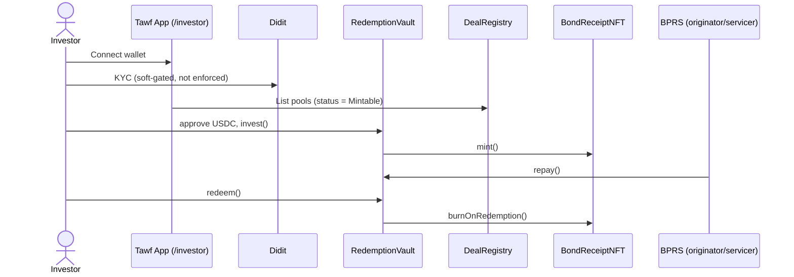
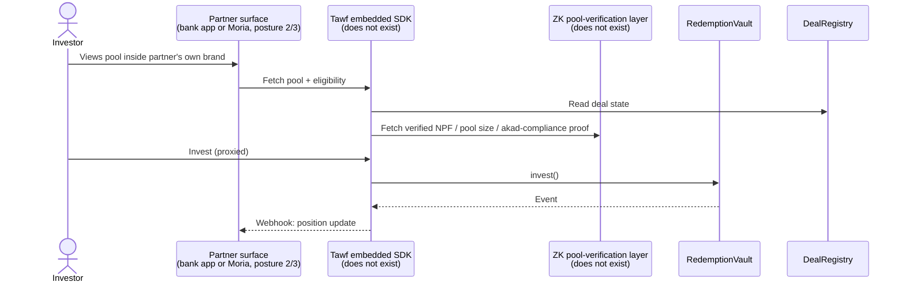

# Business Analysis: The Core Tawf Platform

> Produced with the `business-analyst` skill workflow. Scope: the platform
> itself (the marketplace product, the contracts, the investor app), not a
> specific partner integration. `docs/ba-report-moria-partnership.md`
> already covers the Moria integration end to end. This report exists to
> answer a different question: does the product that exists today actually
> support the pitch and the GTM roadmap this session has been building, or
> is there a gap between what is promised and what is built.
>
> Status: pre-sign-off. Grounded in the live repo (contracts, tests, README)
> and every doc produced this session. Where a claim needed a real number
> instead of an estimate, it was pulled from `forge test --gas-report` run
> against this repo on 2026-09-18, not from memory.

---

## 1. Executive summary

Tawf's own pitch narrative makes two claims that carry real weight in every
external conversation this session has touched: a continuously verifiable
pool (pool size, NPF, akad compliance, the stated "moat" in
`pitch-outline.md`), and a repeatable multi-BPRS rail. Both claims are
sound as a thesis. Neither is fully built yet. This report's central
finding is a gap analysis between those claims and the four contracts that
actually exist today (`DealRegistry`, `BondReceiptNFT`, `RedemptionVault`,
`MockUSDC`), so that the pitch, the GTM roadmap, and the engineering
backlog stay honest with each other as more BPRS partners and Arbitrum
itself get pitched this material.

Second finding: the platform's own distribution posture work (three
postures, `regulation.md` §1.1) and the white-label offer (`gtm-multi-bprs-strategy.md`
§4.2.1) both assume an embedded SDK exists. It does not. That is the
single highest-leverage build item this report identifies, not because it
is technically hard, but because two separate go-to-market threads already
depend on it existing.

## 2. Stakeholders

| Stakeholder | Interest | Source |
|---|---|---|
| Investor | Verifiable, low-minimum exposure to real Shariah financing | README "The Product (investor MVP)" |
| BPRS originator | Funding beyond the local deposit cap, without diluting ownership | `regulation.md` §1 role table |
| DPS and independent Shariah board | Akad validity for every pool | `regulation.md` §3.6 |
| OJK and counsel | Regulatory perimeter, licensing triggers | `regulation.md` throughout |
| Licensed custodian | Fiat and asset custody, never Tawf | `regulation.md` §3.5 |
| Sekuritas partner | Legal issuance, underwriting, disclosure for tradable instruments | `regulation.md` §1 role table |
| Tawf (product and engineering) | Ship the rail, keep the moat real, not just claimed | This report |

## 3. Requirements elicitation and method

Document analysis of the full repo: `README.md`, `contracts/` (source and
tests), and every doc under `docs/`, plus a live `forge test --gas-report`
run for gas figures. No stakeholder interviews. This report covers the
marketplace product and its contracts, not a named partner's integration,
which is why it is a separate document from the Moria BA report rather than
an extension of it.

## 4. Business Requirements Document (BRD)

### 4.1 Business objectives

| ID | Objective | Success metric |
|---|---|---|
| PBO-1 | Make the "continuously verifiable pool" claim in the pitch true, not aspirational | Pool size, NPF, and akad-compliance data is machine-verifiable on-chain or via a published proof, not just a claim in a deck |
| PBO-2 | Make the platform bank-agnostic in practice, not just in theory | A second BPRS can be onboarded without new contract logic, only new deal data |
| PBO-3 | Support the three distribution postures already promised in `regulation.md` §1.1 | Posture 2 (partner embed) and posture 3 (bank embed) are buildable, not just documented |

### 4.2 Business requirements (prioritized, MoSCoW)

| ID | Requirement | Priority | Source |
|---|---|---|---|
| PBR-1 | A pool's size, NPF, and akad-compliance status must be independently verifiable without the bank exposing individual borrower identities | Must | `pitch-outline.md` "The wow (the moat)" |
| PBR-2 | Multiple BPRS originators must be able to list pools on the same marketplace without bespoke per-bank contract deployment | Must | `gtm-multi-bprs-strategy.md` §6 |
| PBR-3 | An embeddable SDK must let a third party (a bank's own app, or a demand-side partner like Moria) surface Tawf pools under its own brand | Must | `regulation.md` §1.1, `gtm-multi-bprs-strategy.md` §4.2.1 |
| PBR-4 | Transfer of a receipt must be governed by a programmable policy per instrument, not a blanket non-transferable rule forever | Should | `secondary-market.md` §1 to §3 |
| PBR-5 | Onboarding a new BPRS must not require re-auditing the core contracts, only configuration | Should | `gtm-multi-bprs-strategy.md` §6 (templating goal) |
| PBR-6 | Investor eligibility must combine Tawf's own KYC with a partner platform's existing KYC where one exists, without a redundant full re-verification | Could | `docs/ba-report-moria-partnership.md` FR-2 |

## 5. Functional Requirements Document (FRD): live vs. required

This is the report's core deliverable. Each row states what exists today
in `contracts/` and the app, against what the pitch or the GTM roadmap
already assumes.

| Capability | Live today | Required by | Gap |
|---|---|---|---|
| Deal lifecycle registry | Yes. `DealRegistry.sol`, states Submitted through Completed/Defaulted, 5 tests-worth of lifecycle functions (`createDeal`, `approveDeal`, `markMintable`, `markMatured`, `completeDeal`, `defaultDeal`) | Everything | None |
| Soulbound receipt | Yes. `BondReceiptNFT.sol`, ERC-1155, non-transferable, `mint` averages 150,739 gas per `forge test --gas-report` (2026-09-18), matching the "~150k" figure already in `pitch-outline.md` and README | Investor MVP | None |
| Escrow, invest, repay, redeem, default claim | Yes. `RedemptionVault.sol`. `invest` averages 228,076 gas, `redeem` averages 134,945 gas, `repay` averages 124,256 gas, `claimDefault` averages 135,393 gas (same gas report) | Investor MVP | None |
| Investor-facing KYC | Yes. Didit integration, env-gated, soft-blocking today per `docs/didit-kyc.md`'s own "Production TODOs" (webhook HMAC verification, DB persistence, hard gate before invest are all still open) | Investor MVP | Three named TODOs already tracked in `didit-kyc.md`, not new findings, restated here because they block PBR-6 |
| Continuously verifiable pool (pool size, NPF, akad compliance) without exposing borrower identity | **No.** Nothing in `contracts/` computes or publishes an NPF figure or an akad-compliance proof. `DealRegistry` stores deal metadata an originator or Tawf enters, it does not verify it against anything | PBO-1, PBR-1, the pitch's own named "moat" (`pitch-outline.md`, `competitors.md` "Where the moat actually is") | **Critical.** This is the single largest gap between the pitch and the product. The competitive positioning against Tennet (`competitors.md`) rests entirely on this capability existing |
| Embeddable SDK / white-label surface | **No.** The `/investor` app is a first-party React app. There is no documented API surface a partner (Moria, or a bank wanting posture 3) could call | PBR-3, `regulation.md` §1.1 postures 2 and 3, `docs/ba-report-moria-partnership.md` FR-1 through FR-5, `gtm-multi-bprs-strategy.md` §4.2.1 | **Critical.** Two separate GTM threads (the Moria integration and the direct-BPRS white-label offer) both assume this exists. Neither can ship without it |
| Multi-originator onboarding tooling (akad template, IT-vendor governance packet) | **No.** `gtm-multi-bprs-strategy.md` §6 names these as the thing that makes bank #2 cheaper than bank #1. They do not exist as artifacts yet, only as a stated goal | PBR-2, PBR-5 | High. Not a contract gap, a process/document gap, but it blocks the phase-gated GTM roadmap (`gtm-multi-bprs-strategy.md` §5) from actually compressing per-bank sales cycles |
| Transfer-policy engine (ERC-3643-style whitelisted transfer) | **No.** `secondary-market.md` §4.1 describes this as a design spec, explicitly "not this turn's implementation." Current receipts are hard-coded non-transferable | PBR-4 | Medium. Correctly sequenced as Phase 2 in `secondary-market.md` §7, not a surprise gap, restated here for completeness against the FRD |
| Outbound webhook/event system (for a partner app to reflect payout status) | **No.** The only webhook in the repo is Didit's inbound KYC webhook, log-only. Nothing pushes deal or receipt state to a third party | `docs/ba-report-moria-partnership.md` FR-5, US-C1 | High. Needed the moment posture 2 or 3 ships, not before |

## 6. Process modeling

### 6.1 As-is: what exists

Every step in this diagram is live. Nothing here is aspirational. This is
the honest baseline the gap analysis in §5 is measured against.

### 6.2 To-be: what the pitch and GTM roadmap already assume exists

The two boxes marked "does not exist" are §5's two Critical gaps. Every
other box in this diagram already has a live counterpart in §6.1.

### 6.3 Disbursement integrity: what actually backs the promise today

The sharpest version of the pool-verification gap is a concrete question
an investor or a partner will eventually ask directly: how do we know the
financing a pool represents actually exists, performs as reported, and
gets remitted in full. Worth answering explicitly rather than leaving
implicit inside §5's gap row.

**What is code-enforced today:** investor capital sits in
`RedemptionVault`, a smart contract, not directly in the BPRS's own
account, from the moment of investment. That is a real, live protection
for the investor's principal at the point of funding.

**What is not code-enforced today:** everything downstream of that. When a
BPRS calls `repay()`, nothing checks that the amount reflects real
collections from real borrowers rather than a partial remittance, a delay,
or the bank covering a shortfall from its own funds to keep a pool looking
healthy. `DealRegistry`'s NPF and pool-size fields are data entered by an
originator or by Tawf, not data verified against anything. The only backing
today is off-chain and reactive: OJK supervision, LPS insurance, and SLIK
reporting mean outright fraud carries real regulatory and audit
consequences (`regulation.md` §2, "the regulator is the attestation
layer"), but that catches misreporting in an audit cycle, it does not
prevent it in real time.

**A staged path, not one big build:**

1. **Tamper-evident attestation.** Require a periodic hash of the BPRS's
   loan tape, co-signed by the DPS, published on-chain. This does not let
   an outsider independently verify the underlying numbers, but it makes
   any later misreporting provable, since the bank cannot quietly rewrite
   history without the hash breaking. Cheap to build, ships well before
   the full verification layer.
2. **Cross-check against SLIK or an LPIP feed.** This is exactly what
   product line 1 in `regulation.md` §2.1 already scopes, a portfolio and
   NPF tool reconciled against an independent credit-bureau or
   regulator-adjacent data source instead of the bank's self-reported
   figures. Once it exists, an NPF claim stops being the bank's word alone.
3. **Full pool verification.** The pitch's actual "moat" claim, provable
   pool size and akad compliance without exposing borrower identity. This
   is the same Critical gap already in §7 below, its engineering cost is
   flagged as unestimated in `docs/pricing-and-infra-cost.md` §4.

None of these three stages exist yet. Stage 1 is the cheapest credible
next step and should be sequenced ahead of stage 3, not treated as a
throwaway interim measure.

## 7. Gap analysis summary

| Gap | Severity | Blocks |
|---|---|---|
| No pool-verification (ZK or otherwise) layer | Critical | The pitch's core competitive claim against Tennet and every other custody-only competitor |
| No embeddable SDK | Critical | Moria integration, the white-label offer to BPRS partners, and by extension the objection-handling strategy in `gtm-multi-bprs-strategy.md` §7 ("board risk aversion" is answered by white-label, which cannot ship without this) |
| No akad/IT-vendor-governance templating artifacts | High | The GTM roadmap's own stated mechanism for making bank #2 cheaper than bank #1 |
| No outbound webhook/event system | High | Any partner-facing posture (2 or 3), and the Moria BA report's own FR-5 |
| KYC hard-gate and persistence TODOs still open | Medium | Already tracked in `didit-kyc.md`, restated here because PBR-6 depends on it |
| No transfer-policy engine | Medium (correctly sequenced) | Secondary market phase 2, already scheduled for later in `secondary-market.md` §7 |

## 8. User stories for the two Critical gaps

### Epic: pool verification layer

**PU-1**
> As an investor, I want to see a pool's NPF ratio and akad-compliance
> status computed from something other than the originator's own claim, so
> that the platform's "verifiable pool" promise is actually verifiable.

- Given a live pool, when I view its detail page, then I see an NPF figure
  and an akad-compliance indicator sourced from a verification process
  documented as trustworthy, not just a field the originator or Tawf typed
  in.
- Given the underlying financing data changes, when the pool is next
  refreshed, then the displayed figures update without a borrower's
  identity ever being exposed.

**PU-2**
> As Tawf, I want the pool-verification method to work without a full ZK
> circuit if one is not ready, so that the moat claim can be made honestly
> at whatever fidelity actually ships first.

- Given no ZK circuit exists yet, when a pool is listed, then the platform
  discloses the current verification method plainly (for example, DPS
  attestation, or a published hash of BPRS-reported figures) rather than
  implying a cryptographic proof that is not there.
- Given a stronger verification method ships later, when it replaces the
  interim one, then existing pools are labeled with which method covers
  them, not silently upgraded without disclosure.

### Epic: embeddable SDK

**PU-3**
> As a partner (Moria, or a BPRS choosing posture 3), I want an API or SDK
> that lets me list pools and submit investments from inside my own app,
> so that I do not have to send my users to Tawf's own branded surface.

- Given a partner has valid API credentials, when they call the pool-list
  endpoint, then they receive the same live `DealRegistry` state the
  first-party app shows, with no data drift between surfaces.
- Given a partner submits an investment through the SDK, when the
  transaction settles, then the partner receives a webhook reflecting the
  new receipt state, matching FR-5 in the Moria BA report.

## 9. Risk log and open items

Cross-reference, do not restate: `regulation.md` §6 (regulatory risk log)
and `gtm-multi-bprs-strategy.md` §11 through §13 (GTM risk log, RAID, and
open questions) already cover the legal and go-to-market risks. This
report's own, platform-specific risks:

| Risk | Note |
|---|---|
| The pitch's "moat" claim gets tested by a sophisticated counterparty (an investor, a competitor, an Arbitrum reviewer) before PU-1/PU-2 ship | Recommend the disclosure language in PU-2 as an interim honesty measure, not a reason to soften the pitch |
| Two GTM threads (Moria, white-label-to-BPRS) both silently assume the SDK in PU-3 exists | Neither thread's timeline should be finalized against a partner without confirming SDK delivery first |
| Gas figures in this report were pulled once, on 2026-09-18, from Sepolia-configured tests, not mainnet | Re-run `forge test --gas-report` before quoting these numbers externally again, contract logic changes would change them |

